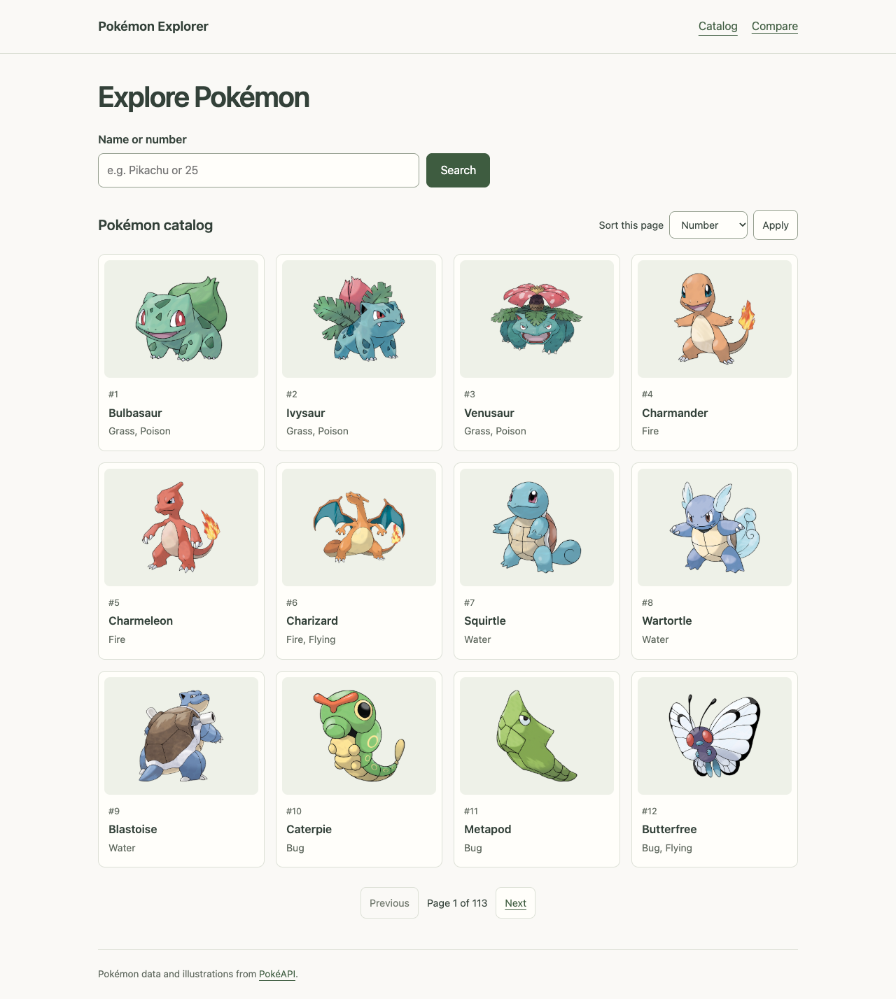
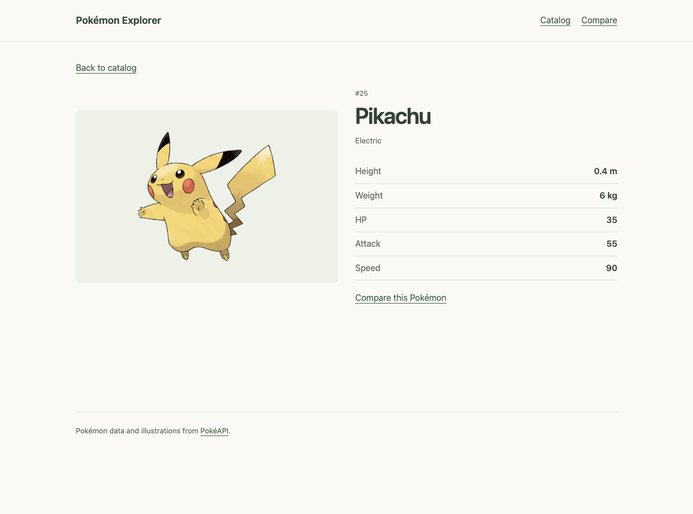
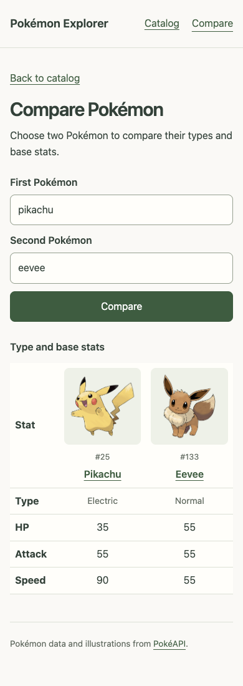

# Pokémon Explorer

Student: **Kuzhiyeva Kamila**

A Node.js, Express and EJS website for browsing, searching and comparing Pokémon.
Data is fetched with Axios from [PokéAPI](https://pokeapi.co/docs/v2/). No API key is needed.

## Features

- Browse 12 Pokémon per page and sort the current page by number or name.
- Search by name or number and view types, measurements and base stats.
- Compare two Pokémon.
- Cache API responses for 20 minutes and show friendly errors and backup images.

## Setup and run

Install Node.js 20 or later, then run these commands in the project folder:

```bash
npm install
cp .env.example .env
npm start
```

On Windows, copy `.env.example` to `.env` manually.
The file contains `PORT=3000`. Open http://localhost:3000 and stop the server with Ctrl+C.
Internet access is needed for new API data and images. Do not upload `.env` or `node_modules`.

## Routes

| Method | Route | Purpose |
| --- | --- | --- |
| GET | `/` | Catalog with pagination and sorting |
| POST | `/search` | Search by name or number |
| GET | `/pokemon/:name` | Pokémon details |
| GET | `/compare` | Compare two Pokémon |

## How it works

Routes call controllers, which validate input and use the API service. EJS templates display
selected data. The service requests Pokémon lists, details and species data, and converts
height and weight to metres and kilograms. Middleware logs requests and handles errors.

Run `npm test` for automated checks of caching, validation, routes and image fallback.

## Screenshots





## Credits

Data and images come from PokéAPI. Pokémon belongs to its respective owners.
Codex helped with code, debugging, tests and documentation.
See [AI Declaration](docs/AI_DECLARATION.md).
